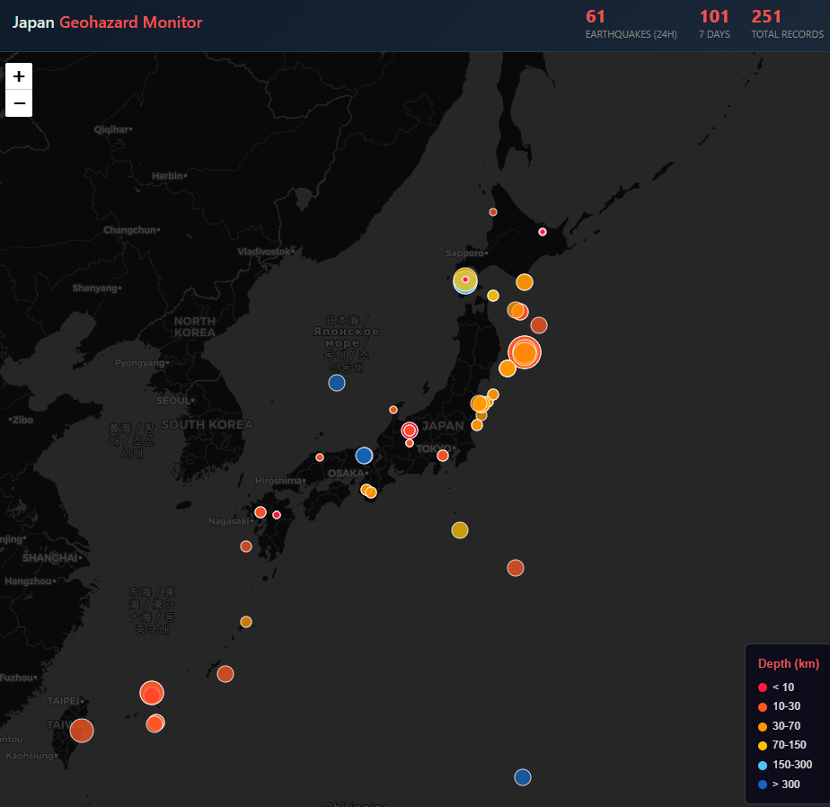
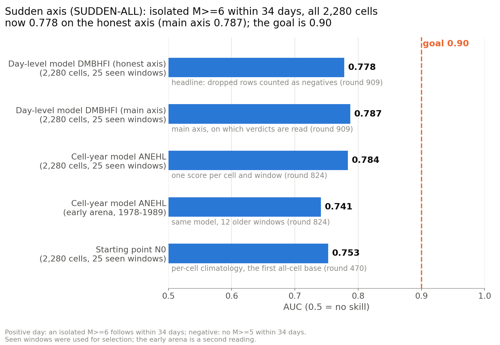
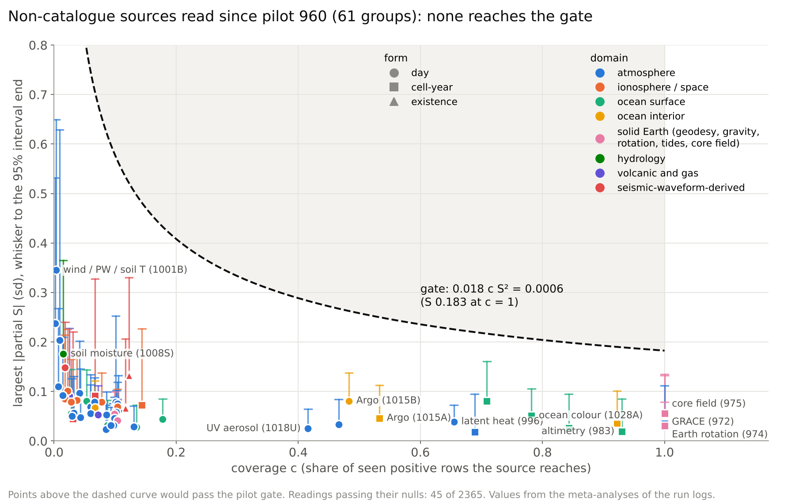

# Japan Geohazard Monitor

> ⚠️ **Disclaimer: this is a research log, not a forecast.**
>
> This repository is a personal research and engineering log. Nothing in it is an earthquake prediction, forecast, warning, advisory, or operational product of any kind, and it issues no alerts. The figures recorded here are retrospective research metrics computed on public catalogues; they are exploratory, may contain errors, and have not been validated for operational use. Do not rely on anything in this repository for safety, evacuation, business, or any other disaster-response decision. For official earthquake and volcano information in Japan, use the Japan Meteorological Agency (https://www.jma.go.jp/en/) and your local government. Everything here is provided as-is, without warranty of any kind, and the author accepts no liability for any loss or damage arising from its use. Data remains the property of the providers listed under Data Attribution.
>
> ⚠️ **免責事項: 本リポジトリは研究記録であり、予報ではありません**
>
> 本リポジトリは個人の研究および開発の記録です。地震の予知・予測・予報・警報その他の運用情報ではなく、いかなる警報も発信しません。記載の数値は公開カタログを用いた事後的な研究指標であり、探索段階のもので、誤りを含む可能性があり、実運用に向けた検証は行っていません。安全確保・避難・事業判断その他の防災上の判断に、本リポジトリの内容を用いないでください。日本の地震・火山の公式情報は気象庁（https://www.jma.go.jp/）および各自治体の発表をご確認ください。本リポジトリの内容は現状のまま無保証で提供され、利用により生じたいかなる損害についても作者は責任を負いません。データの権利は Data Attribution 節に記載の各提供元に帰属します。



Real-time monitoring dashboard for Japan's geophysical activity — earthquakes, volcanoes, atmospheric conditions, geomagnetism, ocean temperature, ionosphere, and crustal deformation — all overlaid on a single dark-themed interactive map with a correlation analysis panel.

9 async collectors run continuously on a Raspberry Pi 5, pulling data from 10 public APIs and storing it in SQLite. A FastAPI server renders a Leaflet.js dashboard with togglable layers and a time-synchronized correlation panel for cross-domain anomaly detection. Mobile responsive.

## Sudden-earthquake axis at a glance

The main research question is whether isolated mainshocks (earthquakes with no foreshock sequence and no recent
precedent in their cell) can be forecast with genuine skill. Details and every number are in
[RESEARCH-LOG.md](RESEARCH-LOG.md). The figures are redrawn automatically (GitHub Actions) whenever
[research/sudden_axis/results.csv](research/sudden_axis/results.csv) changes; each row is appended from a
pre-registered run log by [add_round.py](research/sudden_axis/add_round.py).





## Live

Raspberry Pi 5 + Docker（Tailscaleネットワーク内）

> **Data:** Published as a public Hugging Face Dataset → [yasumorishima/japan-geohazard](https://huggingface.co/datasets/yasumorishima/japan-geohazard).

## Architecture

```
9 async collectors (independent intervals per source)
    → BaseCollector (retry, batch insert, health tracking)
    → SQLite (WAL mode, auto-purge @ 90 days)
    → FastAPI REST API (per-layer + correlation endpoints)
    → Leaflet.js dark-themed map (togglable layers, mobile responsive)
    → Chart.js correlation panel (5 time-aligned charts)
```

**Stack**: Python 3.12 / asyncio + aiohttp + asyncssh / aiosqlite / FastAPI + Uvicorn / scikit-learn + scipy / Leaflet.js + Chart.js / Docker

## Data Sources (10 APIs, 9 collectors)

| Collector | Source | Data | Interval | Records |
|---|---|---|---|---|
| `usgs` | USGS GeoJSON | Earthquakes (global → Japan filter) | 5 min | — |
| `p2p` | P2P地震情報 API | Earthquakes (JMA intensity) | 2 min | — |
| `jma` | 気象庁 Bosai | Earthquakes (COD format) | 3 min | — |
| `amedas` | 気象庁 AMeDAS | Temp / Pressure / Wind / Precip (1,286 stations) | 10 min | ~1,286/fetch |
| `geomag` | NOAA SWPC | GOES magnetometer + Kp index | 15 min | ~1,400/fetch |
| `volcano` | 気象庁 Bosai | 117 active volcanoes + alert levels (1-5) | 15 min | 117/fetch |
| `sst` | NOAA ERDDAP | Sea surface temperature (MUR 0.5° grid) | 6 hours | ~1,725/fetch |
| `tec` | CODE (Bern) IONEX | Ionosphere Total Electron Content (2.5° × 5° grid) | 2 hours | ~1,350/fetch |
| `geonet` | GSI SFTP (terras) | Crustal deformation F5 daily (218 sampled stations) | 24 hours | ~1,500/fetch |

## Map Layers

| Layer | Toggle | Visualization | Color Scheme |
|---|---|---|---|
| Earthquakes | ✅ default on | CircleMarker (mag ∝ radius) | Depth: red (shallow) → blue (deep) |
| Volcanoes | toggle | Triangle markers (SVG) | Alert level: gray=1, yellow=2, orange=3, red=4, purple=5 |
| Sea Surface Temp | toggle | Rectangle grid overlay (0.5°) | Blue (cold) → green → yellow → red (warm) |
| Ionosphere TEC | toggle | Rectangle grid overlay (2.5° × 5°) | Green (low) → yellow → red → purple (high TECU) |
| GEONET | toggle | CircleMarker (displacement ∝ radius) | Green < 5mm, yellow < 15mm, orange < 30mm, red ≥ 30mm |
| AMeDAS | toggle | CircleMarker per station | Metric-dependent colormap (4 selectable metrics) |
| Kp Index | always | Header badge | Green < 4, Orange 4-6, Red > 6 |

## Correlation Panel

Right-side collapsible panel (bottom sheet on mobile) with 5 time-synchronized Chart.js charts for cross-domain anomaly detection:

| Chart | Data | Resolution |
|---|---|---|
| Earthquake count | Hourly bar chart | 1 hour |
| Kp index | Line chart | 3 hours |
| GOES magnetic field | Hourly mean total field (nT) | 1 hour |
| Ionosphere TEC | Mean TEC over Japan (TECU) | Per IONEX epoch |
| Atmospheric pressure | Mean AMeDAS pressure (hPa) | 1 hour |

Supports 3/7/14/30-day windows. Auto-refreshes every 5 minutes when open.

**Use case**: Visual detection of precursor patterns — e.g., ionosphere TEC anomaly → geomagnetic disturbance → pressure change → earthquake sequence.

## API Endpoints

| Endpoint | Description |
|---|---|
| `GET /` | Interactive map dashboard |
| `GET /api/earthquakes?hours=N` | Earthquake list (default 24h) |
| `GET /api/volcanoes` | All volcanoes with current alert levels |
| `GET /api/sst` | Latest SST grid |
| `GET /api/tec?hours=N` | Latest ionosphere TEC grid (default 24h) |
| `GET /api/geonet` | Latest GEONET displacement per station |
| `GET /api/amedas?metric=temperature` | Latest AMeDAS snapshot (pressure/temperature/wind/precipitation) |
| `GET /api/geomag/goes?hours=24` | GOES magnetometer time series |
| `GET /api/geomag/kp?days=7` | Kp index time series |
| `GET /api/correlation?days=7` | Time-aligned multi-domain data for correlation panel |
| `GET /api/stats` | Collector health, counts, latest Kp, volcano alerts |

## Database

SQLite with WAL mode. 10 tables:

- `earthquakes` — dedup by (source, event_id)
- `amedas` — dedup by (station_id, observed_at)
- `geomag_goes` — dedup by (time_tag, satellite)
- `geomag_kp` — dedup by time_tag
- `volcanoes` — upsert by volcano_code (one row per volcano)
- `sst` — dedup by (lat, lon, observed_at)
- `tec` — dedup by (lat, lon, epoch)
- `geonet` — dedup by (station_id, observed_at)
- `focal_mechanisms` — GCMT strike/dip/rake, dedup by (source, event_id)
- `gnss_tec` — high-res 0.25° TEC from Nagoya Univ., dedup by (lat, lon, epoch, source)
- `modis_lst` — MODIS Land Surface Temperature (Kelvin), dedup by (lat, lon, observed_date)
- `ulf_magnetic` — 1-minute geomagnetic H/D/Z/F (nT) from KAK/MMB/KNY, dedup by (station, observed_at)

Auto-purge: records older than 90 days deleted on each collector cycle (real-time tables only; analysis tables retained).

## Deployment

Runs on Raspberry Pi 5 via Docker. GEONET SFTP credentials stored in `.env`:

```bash
# .env (on RPi5, not committed)
GSI_SFTP_PASSWORD=xxxxx

# Deploy
ssh yasu@<RPi5-tailscale-ip> "cd ~/japan-geohazard-monitor && sudo git pull && sudo docker-compose up -d --build"
```

### Self-hosted runner: uploading RPi5-local artifacts to HF (2026-07-25)

The backfill/merge pipeline stays fully cloud-native (PR #166) — this does **not** revive the retired SSD-era topology. What was added is a narrow path for the opposite direction: publishing a derived artifact that only exists on the RPi5.

- A runner named `rpi5-geohazard` is registered again on this repo (labels `self-hosted, Linux, ARM64, rpi5`), installed as a **systemd service** (`svc.sh install`) so it survives reboots.
- `.github/workflows/hf-upload-local.yml` (`workflow_dispatch`, required `memo`) runs `runs-on: [self-hosted, rpi5]` and calls `scripts/hf_upload_local.py`. Because the job runs on the box, it can read a local path directly while **`HF_TOKEN` stays in GitHub Secrets and is never written to the RPi5's disk**.
- `scripts/hf_upload_local.py` refuses raw/archive extensions (`.mseed .sac .cnt .win32 .tar.gz .tgz .tar .zip`) — NIED Hi-net / S-net waveform redistribution is prohibited, so only derived artifacts may pass. After upload it re-reads the remote file list and **fails unless the remote size matches the local size**, then writes a marker under `.hf_published/` (repo, path, size, sha256, timestamp) so the RPi5 janitor can reclaim the local copy later without needing network access or a token. `--dry-run` supported.
- First use: `derived/feature_matrix.json` (156,724,706 bytes — 11×11 grid × 1,816 timesteps × 85 catalogue/stress features) published to [`yasumorishima/japan-geohazard`](https://huggingface.co/datasets/yasumorishima/japan-geohazard). Verified both in-job and independently via the public HF API. The matrix contains only aggregate statistics (`rate_7d`, `b_value`, `etas_residual_*`, `cfs_cumulative_kpa`, `benioff_strain_30d`, …), so no individual waveform can be reconstructed from it.
- The runner is public-repo hosted, so these jobs consume **no GitHub Actions minutes**.

## Data Completeness Initiative

The step-by-step record of this initiative -- about a hundred numbered steps with their dates and outcomes -- lives in [docs/DATA-COMPLETENESS-LOG.md](docs/DATA-COMPLETENESS-LOG.md).  It was kept inline here until 2026-08-23 and was moved unchanged.

## Analysis Results

The research narrative is in [RESEARCH-LOG.md](RESEARCH-LOG.md), newest last.  The per-update summary paragraphs that used to be here are in [docs/update-digest.md](docs/update-digest.md); the earlier analysis phases, the 2026-06 sections, the old roadmap and the not-yet-implemented list are in [docs/history-phases.md](docs/history-phases.md); the retired BigQuery platform is in [docs/history-infra.md](docs/history-infra.md).  All of it was moved unchanged.

## Automated Analysis (GitHub Actions)

Weekly analysis workflow fetches data from 7+ public APIs, runs 20 analysis scripts (Phase 1-4), and stores results as artifacts.

```bash
# Manual trigger
gh workflow run "Earthquake Correlation Analysis" \
  --repo yasumorishima/japan-geohazard-monitor \
  -f memo="Full analysis suite"
```

### Data fetch scripts

| Script | Source | Data |
|---|---|---|
| `fetch_earthquakes.py` | USGS GeoJSON | M3+ earthquakes (yearly chunks, retry with backoff) |
| `fetch_kp.py` | GFZ Potsdam | Kp geomagnetic index (2011-present) |
| `fetch_tec.py` | CODE (Bern) IONEX | Ionosphere TEC 2.5°×5° grid (event ±7d + random baseline) |
| `fetch_cmt.py` | GCMT NDK catalog | Focal mechanisms: strike/dip/rake for Japan M5+ (2011-present) |
| `fetch_gnss_tec.py` | Nagoya Univ. ISEE (AGRID2/GRID2 netCDF) | GNSS-TEC 0.5° grid, 1h temporal, 5.3M records (no auth, 2 hrs/day × 200 dates/run) |
| `fetch_modis_lst.py` | ORNL DAAC TESViS API | MODIS LST 1km: M5.5+ land epicenters ±14d + random control (rate limited) |
| `fetch_kakioka_ulf.py` | INTERMAGNET BGS GIN + WDC Kyoto | KAK/MMB/KNY 1-min geomagnetic: M6+ events ±7d (IAGA-2002 format) |
| `fetch_nmdb_cosmicray.py` | NMDB (Neutron Monitor Database) | Daily cosmic ray count rates: 9 stations (IRKT/OULU/PSNM/APTY/JUNG/ATHN/ROME/BKSN/AATB), 2011-present (no auth) |
| `fetch_cses_satellite.py` | INTERMAGNET BGS GIN + CSES-Limadou | KAK/MMB/KNY 1-min geomag → hourly downsample (2011-2026, 7-day batch) + CSES satellite EM (2018+, auth required) |
| `fetch_blitzortung.py` | Blitzortung.org + Univ. Bonn sferics | Lightning stroke counts aggregated to 2° grid cells (Japan region, `lightning` table) |
| `fetch_iss_lis_lightning.py` | NASA GHRC DAAC (Earthdata auth) | ISS LIS flash counts 2017-2023, 2° cells (`iss_lis_lightning` table, separate from Blitzortung) |
| `fetch_wwlln_thunder_hour.py` | NASA GHRC DAAC (Earthdata auth) | WWLLN Monthly Thunder Hour 2013-2025, 2° cells via max-aggregation from native 0.05° (`lightning_thunder_hour` table) |
| `fetch_movebank.py` | Movebank (Max Planck) | Animal GPS tracking in Japan region: movement speed/dispersion anomalies |
| `fetch_olr.py` | NOAA PSL THREDDS NCSS | Daily outgoing longwave radiation (2.5° grid, Japan region, no auth) |
| `fetch_iers_eop.py` | OBSPM Paris Observatory / USNO | Earth Orientation Parameters: LOD, polar motion (eopc04 + finals2000A fallback) |
| `fetch_solar_wind.py` | NASA OMNIWeb FTP | Hourly solar wind: Bz GSM, dynamic pressure, Dst (no auth) |
| `fetch_grace_gravity.py` | NASA PO.DAAC / GFZ ISDC | GRACE/GRACE-FO mascon gravity (Earthdata auth via `earthdata_auth.py`) |
| `fetch_omi_so2.py` | NASA GES DISC OPeNDAP | OMI SO2 column density Level 3 (Earthdata auth via `earthdata_auth.py`) |
| `fetch_smap_moisture.py` | NASA AppEEARS | SMAP L3 soil moisture 9km (Earthdata auth via `earthdata_auth.py`) |
| `fetch_tide_gauge.py` | UHSLC (Univ. Hawaii) | Fast Delivery hourly sea level (9 Japan stations, `.dat` format, no auth) |
| `fetch_ocean_color.py` | NASA OB.DAAC OPeNDAP | MODIS Aqua chlorophyll-a Level 3 (Earthdata auth via `earthdata_auth.py`) |
| `fetch_cloud_fraction.py` | NASA LAADS DAAC | MODIS Terra MOD08_D3 cloud fraction (Earthdata auth via `earthaccess` library) |
| `fetch_viirs_nighttime.py` | EOG / NASA LAADS | VIIRS Day/Night Band radiance composites (Earthdata auth via `earthdata_auth.py`) |
| `fetch_insar.py` | COMET LiCSAR | Sentinel-1 InSAR LOS velocity (Japan frames, no auth) |
| `fetch_goes_xray.py` | NOAA SWPC | GOES 1-8Å X-ray flux (solar flare proxy, no auth) |
| `fetch_goes_proton.py` | NOAA SWPC | GOES ≥10 MeV proton flux (SEP events, no auth) |
| `fetch_tidal_stress.py` | Pure calculation | Lunar + solar tidal shear stress at Japan (no external data) |
| `fetch_poes_particles.py` | NOAA SWPC | GOES ≥2 MeV electron flux (particle precipitation, no auth) |
| `earthdata_auth.py` | — | Shared NASA Earthdata auth: Bearer token + Basic Auth redirect fallback (OPeNDAP). LAADS DAAC requires `earthaccess` library instead (Bearer not honored on /archive/ or /opendap/) — see `fetch_cloud_fraction.py`. |
| `fetch_dart_pressure.py` | NOAA NDBC | DART ocean bottom pressure: 5 Japan-area stations, historical + realtime (no auth) |
| `fetch_ioc_sealevel.py` | IOC/VLIZ | Sea level monitoring: Japan coastal stations, REST API (no auth, 1 req/min) |
| ~~`fetch_snet_pressure.py`~~ | ~~NIED Hi-net~~ | **[DEPRECATED 2026-04-25, Phase 1 Step 4aa]** S-net BPR is unavailable via HinetPy; tombstone stub retained (see Phase 1 Step 4aa entry in the **Data Completeness Initiative** bullet). |
| `validate_data.py` | Local DB | **Data completeness validation**: checks all 30 tables for existence, row count, date range coverage. Outputs JSON report + human-readable summary. Runs twice per workflow (post-fetch + final) |
| ~~`load_raw_to_bq.py`~~ | ~~Local DB → BQ~~ | **[DEPRECATED 2026-05-11, PR #156]** SQLite → BigQuery loader retired after BQ Sandbox 10 GB free tier reached 98 % (`ioc_sea_level` growth) and audit found zero BQ READ paths in the codebase. Script retained in `scripts/` for reference. Primary persistence moved to RPi5 SSD (PR #157). |

### Analysis scripts

| Script | Phase | Method | Reference |
|---|---|---|---|
| `run_analysis.py` | 1 | b-value, TEC, multi-indicator (isolation, balanced sampling, bootstrap CI) | — |
| `coulomb_analysis.py` | 2 | Coulomb Failure Stress, Okada model, spatial control (shifted baseline) | Okada (1992), Toda & Stein (2011) |
| `etas_analysis.py` | 2 | Model-free regional rate anomaly + constrained ETAS residuals | Ogata (1988, 1998) |
| `cluster_analysis.py` | 2 | Nearest-neighbor distance clustering, foreshock detection (bootstrap, temporal stability) | Zaliapin & Ben-Zion (2013) |
| `validate_phase2.py` | 2.5 | Aftershock isolation + time delay + signal correlation + prospective test | — |
| `lurr_analysis.py` | 3 | Load-Unload Response Ratio from tidal stress classification | Yin et al. (2006) |
| `natural_time_analysis.py` | 3 | Natural time variance κ1 criticality detection (threshold 0.070) | Varotsos et al. (2011) |
| `nowcast_analysis.py` | 3 | Earthquake Potential Score from inter-event M3+ cycle counting | Rundle et al. (2016) |
| `modis_lst_analysis.py` | 3b | MODIS thermal IR anomaly: RST/RETIRA method, isolation, magnitude/depth dependence | Tramutoli (2005), Tronin (2006) |
| `ulf_analysis.py` | 3b | ULF spectral power, Sz/Sh polarization, Higuchi fractal dimension (nighttime only) | Hayakawa (2007), Hattori (2004) |
| `gnss_tec_analysis.py` | 3b | High-resolution GNSS-TEC (0.5°) anomaly at epicenters: day/night split, isolation filter, forward alarm evaluation | — |
| `pattern_informatics.py` | 4 | Pattern Informatics: seismicity pattern change detection on 0.5° grid, prospective test | Rundle (2003), Tiampo (2002) |
| `prospective_analysis.py` | 4 | **Forward-looking prediction**: ETAS residual + cumulative CFS + foreshock alarms + ML alarm. Cell-based base rate, Molchan score, information gain. Train 2011-2018, test 2019-2026 | Molchan (1991), Zechar & Jordan (2008), Ogata (1998) |
| `ml_prediction.py` | 8-14 | Multi-target ML (M5+/M5.5+/M6+): up to 79 features (dynamic selection across 22 groups) → **feature stability selection** (3-fold preliminary CV, permutation importance, auto-exclude unstable features) → HistGradientBoosting + **RandomForest + LogisticRegression** (diverse level-0) with class weighting, walk-forward CV, zone-specific ETAS MLE, 2-pass spatial smoothing, level-0 export for stacking + **spatial feature matrix export for ConvLSTM** (full Phase 9+ data). Phase 9: cosmic ray, geomag spectral. Phase 10/10b: OLR, Earth rotation, solar wind, GRACE gravity, SO2, soil moisture, tide gauge, ocean color, cloud fraction, nightlight, InSAR. Phase 11: X-ray, proton, tidal stress, particle precipitation. Phase 13: DART bottom pressure, IOC sea level, S-net seafloor pressure | van den Ende & Ampuero (2020), Matsuo & Heki (2011), Homola (2023), Baba (2020), Aoi (2020) |
| `export_csep.py` | 8 | CSEP-compatible XML/JSON forecast export from ML predictions | Schorlemmer et al. (2007) |
| `csep_benchmark.py` | 8 | CSEP benchmark: Uniform/Smoothed/RI/ETAS reference models + N/L/T-test + Molchan diagram | Helmstetter (2007), Rhoades (2004) |
| `stacking_analysis.py` | 8-14 | Ensemble stacking: up to 14-input level-0 (HistGBT×3 + RF×3 + LR×3 + physics×5) → logistic/isotonic meta-learner. Auto-fallback to 8 features when diverse models unavailable | Wolpert (1992) |
| `cosmic_ray_analysis.py` | 9 | Cosmic ray anomaly: 27-day solar rotation baseline deviation, 15-day trend (Homola lag), Forbush decrease detection, multi-station differential | Homola et al. (2023) |
| `export_feature_matrix.py` | 8-14 | 4D tensor export (timesteps×H×W×C) for ConvLSTM/GNN GPU training. Phase 14: also exported from ml_prediction.py with full Phase 9+ data (not zero-filled) | — |
| `colab/geohazard_convlstm.py` | 8+ | ConvLSTM spatiotemporal: 2-layer ConvLSTM + SE attention, AdamW + CosineAnnealingLR, walk-forward CV | Shi et al. (2015), DeVries et al. (2018) |
| `colab/geohazard_gnn.py` | 8+ | SeismoGNN: GATv2Conv×3 (4-head) + GRU temporal, fault-network graph (8-neighbor + tectonic zone edges), walk-forward CV | SeismoQuakeGNN (2025), Stein (1999) |

### Shared modules (`src/`)

| Module | Purpose |
|---|---|
| `physics.py` | Okada (1992) CFS, Wells & Coppersmith (1994) fault scaling, ETAS MLE (scipy L-BFGS-B), Dieterich (1994) rate-and-state, b-value (Aki-Utsu), tectonic zone classification, GNSS strain rate estimation, slow-slip transient detection |
| `features.py` | **78 features** with dynamic selection across **22 optional groups**: rate dynamics (acceleration, trend), zone-specific ETAS residuals, magnitude statistics (deficit, b-value trend), clustering (foreshock escalation, inter-event CV), rate-and-state CFS, Pattern Informatics, Benioff strain, GNSS crustal deformation (displacement, strain rate, SSE detection), enhanced spatial (neighbor CFS/ETAS/mag, zone rate anomaly, CFS rank, spatial gradient), **cosmic ray** (27-day baseline deviation, trend), **geomagnetic spectral** (ULF power, polarization, fractal dim), **OLR anomaly**, **Earth rotation** (LOD rate, polar motion speed), **solar wind** (Bz, dynamic pressure, Dst), **GRACE gravity** anomaly rate, **SO2 column** anomaly, **soil moisture** anomaly, **tide gauge** residual, **ocean color** chlorophyll anomaly, **cloud fraction** anomaly, **nightlight** airglow anomaly, **InSAR** deformation rate, **X-ray flux** (solar flare proxy), **proton flux** (SEP events), **tidal shear stress** + rate (lunar+solar), **particle precipitation** (Van Allen belt), **DART bottom pressure** (anomaly + rate), **IOC sea level** anomaly, **S-net seafloor pressure** anomaly. `get_active_feature_names()` auto-excludes groups with no data. **Performance**: bisect-based O(log n) window queries, per-day zone stats cache, deque histories — optimized for 100K+ extract() calls per target |
| `evaluation.py` | ROC-AUC, threshold evaluation (precision/recall/gain/IGPE/Molchan), walk-forward CV splits, isotonic calibration (PAV), reliability diagram, permutation importance, Molchan area skill score |
| `target_config.py` | Multi-target configuration: M5+/M5.5+/M6+ with per-target window, class weight, positive thresholds |
| `csep_format.py` | CSEP XML forecast generation: probability → GR-based rate per cell/magnitude/time bin |
| `stacking.py` | Ensemble stacking: level-0 registration (HistGBT + RF + LR × 3 targets + 5 physics = up to 14 features), logistic/isotonic meta-learner, walk-forward stacking with temporal leak prevention |

Results saved as JSON artifacts (90-day retention). Analysis runs every Monday 12:00 JST or on demand (400-min timeout). **Backfill** runs every 3 hours 24/7 (`backfill.yml`) for SO2/cloud/geomag continuous data ingestion with BQ upload + Discord/Issue alerts. As of 2026-04-18 it is split into 3 parallel jobs (`heavy` 290m + `light` 200m + `merge` 60m via `needs:`) so the GitHub 5h hard limit no longer cancels Upload-to-BigQuery — see Phase 1 Step 4e for the kill-chain analysis. **Data preservation**: DB checkpoint uploaded only after verified WAL flush passes (`flush_ok` guard). `validate_data.py` checks all 30 tables twice per run.

### Persistence Tiers

`backfill.yml` の merge job が出力する `geohazard.db` の保存階層 (PR #166、 2026-05-28 以降、 fully cloud-native):

| 階層 | 場所 | 役割 | 容量 | 保持 |
|---|---|---|---|---|
| Canonical (durable) | **Hugging Face dataset** [`yasumorishima/japan-geohazard`](https://huggingface.co/datasets/yasumorishima/japan-geohazard) `geohazard.db` (+ sidecar `geohazard.db.rowcounts.json`) | merge job が `scripts/hf_sync.py` で upload (integrity_check fail-closed + **row-count no-regression guard**: sidecar manifest と per-table 比較で degraded 上書き防止 — compaction は通過・テーブル脱落は拒否、 旧 byte-size guard を 2026-07-05 に置換 + 絶対下限 5 GB + `super_squash_history` で LFS 履歴を畳む) | LFS ~42 GB (2026-07-29 実測、 2026-07-05 の compaction 後に `ioc_sea_level` 等の backfill で再成長) | 永続 (public dataset) |
| Working (per-run) | **GH Actions artifact** `backfill-checkpoint-<run_id>` | merge job が常時 upload、 各 fetch job の restore step が次 run で読む incremental chain | 30 GB cap | **3 day rolling** (`e759fe5`、 2026-07-15 に 30→3 へ短縮。 この保持期間を超える run ドラウトが起きると chain が失効する — 2026-07-24 の事象を参照) |
| Scratch (during merge) | **`ubuntu-latest` ephemeral** `/mnt/merge/{light,modis,so2,cloud,snet,hinet}/geohazard.db` | `actions/download-artifact@v4` が merge job 中に展開 (root fs に dst、 `/mnt` に inputs を分散して ~33 GB ピーク (`shutil.copyfile(base, dst)`) を 2 FS に振り分け) | ~33 GB peak | 一時 (job 終了で破棄) |

> Hugging Face upload は **UTC 00:00 cron の1本のみ**で発火 (LFS 履歴肥大防止)。 targeted `workflow_dispatch` (`target != 'all'`) では Canonical / Working tier への upload を skip (該当 run が部分テーブルしか更新しないため、 他テーブルの状態を巻き戻すのを防ぐ)。 緊急時は `.github/workflows/reseed-checkpoint-from-hf.yml` で Canonical → Working chain を再シード可能。

## Data Attribution

- Earthquake data: USGS, P2P地震情報, 気象庁
- Focal mechanisms: Global CMT Project (Ekström et al., 2012)
- AMeDAS / Volcano: 気象庁
- Geomagnetic: NOAA SWPC, GFZ Potsdam, WDC Kyoto (Kakioka Observatory)
- SST: NASA JPL MUR SST v4.1 via NOAA ERDDAP
- Ionosphere TEC: CODE (University of Bern), Nagoya University ISEE GNSS-TEC
- Land Surface Temperature: NASA MODIS MOD11A1 via LAADS DAAC
- GEONET: 国土地理院 (Geospatial Information Authority of Japan)
- Cosmic rays: NMDB (Neutron Monitor Database, nmdb.eu), operated by 9 NMDB stations (IRKT/OULU/PSNM/APTY/JUNG/ATHN/ROME/BKSN/AATB)
- Animal tracking: Movebank (movebank.org), Max Planck Institute of Animal Behavior
- Lightning: Blitzortung.org community lightning network, University of Bonn sferics archive, NASA WWLLN (Univ. of Washington) via GHRC DAAC, NASA ISS LIS via GHRC DAAC
- Satellite EM: CSES-Limadou (ASI/SSDC), INTERMAGNET (BGS Edinburgh GIN)
- Outgoing longwave radiation: NOAA Climate Data Record (CDR) OLR Daily
- Earth orientation: IERS (International Earth Rotation and Reference Systems Service)
- Solar wind: NASA OMNIWeb (SPDF/GSFC), ACE/DSCOVR/Wind spacecraft
- Gravity: NASA/DLR GRACE/GRACE-FO, JPL Mascon RL06.3v04 (PO.DAAC)
- Atmospheric SO2: NASA OMI OMSO2e Level 3 (GES DISC)
- Soil moisture: NASA SMAP L3 (NSIDC) via AppEEARS
- Tide gauge: University of Hawaii Sea Level Center (UHSLC) Research Quality
- Ocean color: NASA MODIS Aqua Level 3 chlorophyll-a (OB.DAAC)
- Cloud fraction: NASA MODIS Terra MOD08_D3 (LAADS DAAC)
- Nighttime light: VIIRS Day/Night Band (EOG, Colorado School of Mines / LAADS DAAC)
- InSAR: ESA Sentinel-1 via COMET LiCSAR (NERC/JASMIN)
- Ocean bottom pressure (DART): NOAA National Data Buoy Center (NDBC), public domain
- Sea level monitoring: Flanders Marine Institute (VLIZ); Intergovernmental Oceanographic Commission (IOC). Sea level station monitoring facility. DOI: [10.14284/482](https://doi.org/10.14284/482). **Commercial use prohibited.**
- Seafloor pressure (S-net): National Research Institute for Earth Science and Disaster Resilience (NIED). NIED Hi-net, DOI: [10.17598/NIED.0003](https://doi.org/10.17598/NIED.0003). **Citation, acknowledgment, and reprint submission required. Redistribution prohibited.** See [Hi-net terms](https://www.hinet.bosai.go.jp/about_data/?LANG=en)

## Data Usage Notes

Some data sources have specific usage requirements beyond standard academic citation:

| Source | License | Requirement |
|---|---|---|
| **NIED Hi-net/S-net** | Custom (strict) | Acknowledge NIED + all data-providing institutions. Send reprints to NIED (Tsukuba). Cite DOI: [10.17598/NIED.0003](https://doi.org/10.17598/NIED.0003). Cite Okada et al. (2004) doi:10.1186/BF03353076. **Redistribution prohibited. Non-compliance may result in service termination.** |
| **INTERMAGNET** | CC BY-NC 4.0 | Acknowledge: *"The results presented in this paper rely on data collected at magnetic observatories. We thank the national institutes that support them and INTERMAGNET for promoting high standards of magnetic observatory practice."* Send citations to INTERMAGNET Secretary. **Non-commercial only.** |
| **NMDB** | Non-commercial | Acknowledge: *"We acknowledge the NMDB database (www.nmdb.eu), founded under the European Union's FP7 programme (contract no. 213007) for providing data."* + per-station acknowledgments (see nmdb.eu/station). **Non-commercial only.** |
| **Global CMT** | Citation required | Cite: Ekström, G., M. Nettles, and A.M. Dziewoński (2012) Phys. Earth Planet. Inter. 200-201:1-9, doi:[10.1016/j.pepi.2012.04.002](https://doi.org/10.1016/j.pepi.2012.04.002) |
| **GFZ Kp index** | CC BY 4.0 | Cite GFZ as data source. DOI: [10.5880/Kp.0001](https://doi.org/10.5880/Kp.0001). Ref: Matzka et al. (2021) doi:[10.1029/2020SW002641](https://doi.org/10.1029/2020SW002641) |
| **Kakioka Observatory** | JMA terms | DOI assigned per dataset (see kakioka-jma.go.jp). Source: JMA. |
| **IOC Sea Level** | Non-commercial | Cite VLIZ/IOC with DOI: [10.14284/482](https://doi.org/10.14284/482). **Commercial use prohibited.** |
| **COMET LiCSAR** | Copernicus terms | Acknowledge: *"LiCSAR contains modified Copernicus Sentinel data [year] analysed by COMET. LiCSAR uses JASMIN."* Cite Lazecký et al. (2020) Remote Sensing. |
| **JMA (earthquake/AMeDAS/volcano)** | PDL1.0 (≈CC BY 4.0) | Source: Japan Meteorological Agency website. Meteorological Service Act restrictions apply to forecast services. |
| **GSI GEONET** | PDL1.0 | Source: GSI website (url). |
| **P2P地震情報** | CC BY 4.0 | Attribute 気象庁 for earthquake data (pre-2021/4/4). Commercial use OK. |
| **NOAA (DART/SWPC/NDBC/ERDDAP)** | Public domain | Do not imply NOAA endorsement. |
| **NASA (Earthdata sources)** | Open data | Cite specific datasets per NASA data policy. |
| **Nagoya Univ. ISEE GNSS-TEC** | ©Nagoya Univ. | Cite Shinbori et al. (2022) doi:[10.1029/2021JA029687](https://doi.org/10.1029/2021JA029687). Acknowledge IUGONET + NICT Science Cloud. List GNSS data providers. |
| **CODE (Univ. Bern) TEC** | Citation required | Cite Dach et al. (2024) DOI: [10.48350/197025](https://doi.org/10.48350/197025) |
| **Movebank** | Per-study license | Follow per-study license. Contact data owner for non-CC0 data. |
| **UHSLC** | ©UHSLC | Standard academic citation. SA stations require SANHO permission. |

## Related

Part of the [Realtime Open Data](https://github.com/yasumorishima/realtime-open-data) project collection.

## License

MIT

## Related (private)

- Forecasting research probe & analysis tooling: <https://github.com/yasumorishima/geohazard-research-private> (private)
